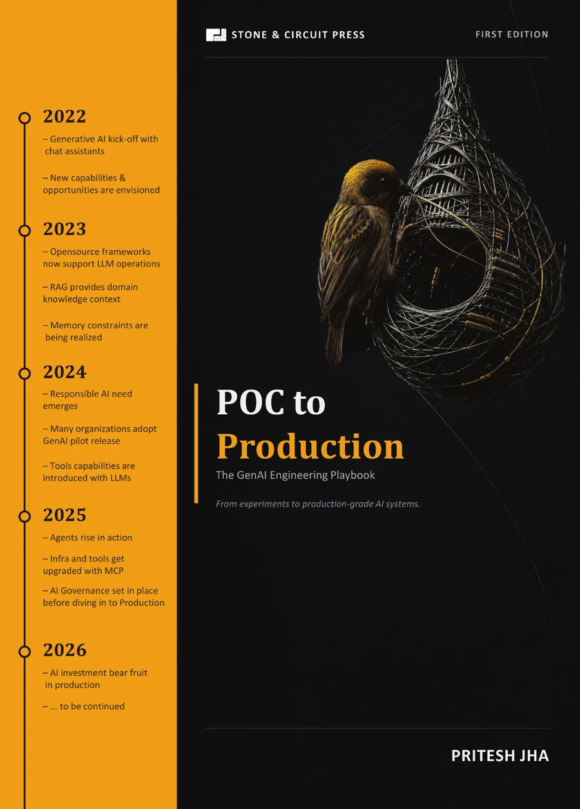

# Hi, I’m Pritesh Jha

AI Engineering Leader • Open-Source Researcher • Published Author

Manager — AI Engineering at EY, building production AI systems across financial services, healthcare, and insurance.

#### Visit my website: [https://www.pritesh-jha.in/](https://www.pritesh-jha.in/)

---

# Published Book

<table>
  <tr>
    <td width="260" align="center" valign="top">
      
    </td>
    <td valign="top">
      
<strong>POC to Production</strong> The GenAI Engineering Playbook

      
<em>From experiments to production-grade AI systems.</em>

      
My guide to taking a GenAI application from proof of concept through pilot to production. Follow one evolving system, with real Git commits connecting each chapter to working code.

      <ul>
        <li><strong>Build:</strong> RAG, conversational memory, guardrails, and agentic workflows.</li>
        <li><strong>Validate:</strong> evaluation, security, failure handling, and cost control.</li>
        <li><strong>Ship:</strong> Kubernetes on AWS, CI/CD, and observability.</li>
      </ul>
      
<a href="https://stoneandcircuit.com/books/poc-to-production"><strong>Get the Book →</strong></a>

      
<strong>Follow the companion code</strong> 
        <a href="https://github.com/pritesh-2711/genai-poc-to-prod">POC</a> →
        <a href="https://github.com/pritesh-2711/poc2prod-pilot-deployment">Pilot deployment</a> →
        <a href="https://github.com/pritesh-2711/poc2prod-production-deployment">Production deployment</a>
      

    </td>
  </tr>
</table>

---

I build **production-grade AI systems** focused on:

* Deep Learning & Machine Learning Models
* LLM Infrastructure & Agent Platforms
* AI Security & Compliance
* Intelligent Document Processing
* Performance Engineering & Distributed AI Systems
* Reliability & Evaluation

---

# Featured Repositories

| Repository                                                                                         | Focus                                                                      |
| -------------------------------------------------------------------------------------------------- | -------------------------------------------------------------------------- |
| [RaV-IDP](https://github.com/pritesh-2711/RaV-IDP)                                                 | Reconstruction-as-validation framework for trustworthy document extraction |
| [anonypii](https://github.com/pritesh-2711/anonypii)                                               | Production-ready anonymization & deanonymization toolkit                   |
| [pii-bench](https://github.com/pritesh-2711/pii-bench)                                             | Open benchmark dataset & fine-tuning workflows for PII detection           |
| [python-performance-playbook](https://github.com/pritesh-2711/python-performance-playbook)         | Real-world concurrency, async, multiprocessing & benchmark systems         |
| [genai-poc-to-prod](https://github.com/pritesh-2711/genai-poc-to-prod)                             | Building GenAI systems beyond demos into production-ready architectures    |
| [mcp-tools-library](https://github.com/pritesh-2711/mcp-tools-library)                             | MCP server integrations & tool orchestration patterns                      |
| [build-transformers-from-scratch](https://github.com/pritesh-2711/build-transformers-from-scratch) | Transformer internals without abstraction shortcuts                        |
| [neural-network-from-zero](https://github.com/pritesh-2711/neural-network-from-zero)               | Manual backpropagation & optimization dynamics                             |
| [ml-from-scratch](https://github.com/pritesh-2711/ml-from-scratch)                                 | ML algorithms implemented from first principles                            |

---

# Support My Work

Open-source AI research and infrastructure experiments require significant compute, time, and engineering effort.

If my work helps you:

* consider starring repositories
* sharing projects
* contributing
* sponsoring ongoing research & infrastructure work

GitHub Sponsors:
https://github.com/sponsors/pritesh-2711

---

# Connect

* GitHub:
  https://github.com/pritesh-2711

* LinkedIn:
  https://linkedin.com/in/priteshjha27

* Hugging Face:
  https://huggingface.co/Pritesh-2711

* Medium:
  https://medium.com/@priteshjha27

* YouTube — Build With Pritesh:
  https://youtube.com/@BuildWithPritesh

---
